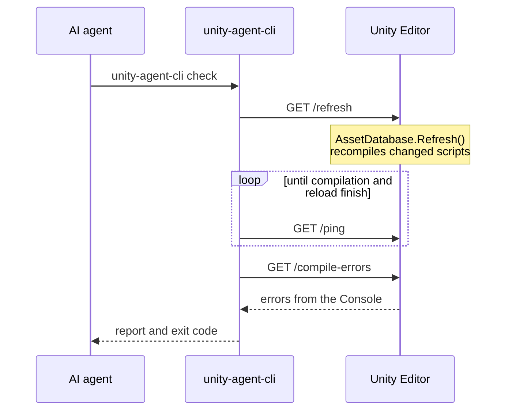

<div align="center">
  <h1>Unity Agent Bridge</h1>
  <p><b>Let AI coding agents compile their C# in your running Unity Editor, and fix their own mistakes.</b></p>
  <a href="https://www.npmjs.com/package/unity-agent-cli"></a>
  <a href="https://github.com/ruizhengu/unity-agent-bridge/actions/workflows/ci.yml"></a>
  <a href="https://github.com/ruizhengu/unity-agent-bridge/stargazers"></a>
  
  
  <a href="LICENSE"></a>
</div>

<br>

```text
$ unity-agent-cli check
✗ Unity found 1 compile error · 4.1s

  Assets/Scripts/PlayerController.cs:15:10
  error CS1002: ; expected

Fix the errors above, then run unity-agent-cli check again.

  … the agent adds the missing semicolon …

$ unity-agent-cli check
✓ Unity compiled successfully · 6.3s
```

## Features

- **Closes the loop**: after editing C#, your agent runs one command and gets Unity's real compiler errors back, so it fixes them before you switch windows
- **One-command setup**: `unity-agent-cli init` adds the Unity package and the agent instructions to your project
- **Works with any agent**: Claude Code, Codex, Cursor, Copilot, Gemini CLI, or anything else that can run a shell command
- **Clear answers**: `file:line:column` locations, exit codes an agent can act on, and `--json` for scripts
- **Explains itself**: `unity-agent-cli doctor` checks every link in the chain and tells you how to fix what's broken
- **Small and local**: zero dependencies, talks only to `127.0.0.1`, no accounts, no telemetry

## Quick Start

You need Unity 2021.3 or newer and Node.js 18 or newer.

**1. Install the CLI**

```bash
npm install -g unity-agent-cli
```

Run the same command again later to update.

**2. Set up your Unity project**

```bash
cd path/to/YourUnityProject
unity-agent-cli init
```

`init` adds the Unity package to `Packages/manifest.json` and writes compile-check instructions to `AGENTS.md`, plus a `CLAUDE.md` that points to it. Add `--dry-run` to preview first.

**3. Switch to Unity, then confirm**

Unity imports the package as soon as it has focus again. Then run:

```bash
unity-agent-cli doctor
```

When it says **All set**, ask your agent to change some C#. It will check its own work.

**With an AI agent**

Tell your agent:

> Set up unity-agent-bridge for this Unity project by reading https://raw.githubusercontent.com/ruizhengu/unity-agent-bridge/main/llms.txt

**Run**

```bash
unity-agent-cli check                # Recompile in Unity and report errors
unity-agent-cli check --json         # Same, as JSON
unity-agent-cli check --strict       # Fail on compiler warnings too
unity-agent-cli doctor               # Diagnose the connection and project setup
unity-agent-cli init --dry-run       # Preview what init would change
unity-agent-cli --help               # Everything else
```

<details>
<summary><strong>Other ways to install</strong></summary>

**Agent skill**: teaches Claude Code, Codex, Cursor and other agents when and how to run the check, without touching your project's `AGENTS.md`:

```bash
npx skills add ruizhengu/unity-agent-bridge -g -y
```

As a Claude Code plugin: `/plugin marketplace add ruizhengu/unity-agent-bridge`, then `/plugin install unity-agent-bridge@unity-agent-bridge`.

**Unity package by hand**: in Unity, open **Window › Package Manager**, click **+**, choose the git URL option, and paste:

```text
https://github.com/ruizhengu/unity-agent-bridge.git?path=/UnityPackage
```

**CLI from the latest unreleased code**:

```bash
npm install -g github:ruizhengu/unity-agent-bridge
```

**CLI from a clone**:

```bash
git clone https://github.com/ruizhengu/unity-agent-bridge.git
cd unity-agent-bridge
npm link
```

</details>

## How it works



1. The **Unity package** starts a small HTTP server on `127.0.0.1:5142` when the Editor loads. It can refresh the AssetDatabase, say whether Unity is compiling, and read compile errors from the Console.
2. The **CLI** asks Unity to refresh, waits for compilation (and the domain reload after a successful compile), then reads the errors and prints a short report.
3. The **exit code** tells the agent what to do next:

| Exit | Meaning | The agent should |
|---|---|---|
| `0` | Unity compiled the project | Carry on. Warnings are listed but don't block |
| `1` | Compile errors | Fix them and run the check again |
| `2` | Couldn't reach Unity | Run `doctor` and ask you for help |

## Example

Ask your agent for something that's easy to get wrong:

> Create `Assets/Scripts/SceneLoader.cs` with a method that loads the "MainMenu" scene.

If the agent forgets `using UnityEngine.SceneManagement;`, the check catches it:

```text
✗ Unity found 1 compile error · 5.2s

  Assets/Scripts/SceneLoader.cs:12:9
  error CS0103: The name 'SceneManager' does not exist in the current context
```

The agent adds the directive, runs the check again, gets exit `0`, and only then tells you it's done.

## Configuration

It works without configuration.

- `UNITY_AGENT_TIMEOUT` (60): seconds to wait for Unity to come back after it reloads scripts. Raise it for large projects.
- `NO_COLOR`: plain output. Colors and the spinner already switch off when output isn't a terminal, so agents always get clean text.

## Troubleshooting

Start with `unity-agent-cli doctor`. It checks each piece and prints a `→` hint for anything that's wrong.

- **"Can't reach Unity"**: the Editor has to be open with your project, and the package installed. Unity's Console should show `Unity Agent Server started on http://127.0.0.1:5142/`.
- **"Port 5142 is already in use" in the Unity Console**: only one Unity Editor can own the bridge. Close the other project (or whatever `doctor` names), then restart Unity.
- **A check takes about 8 seconds even when nothing changed**: Unity never says "nothing to compile", so the CLI waits a moment to see whether compilation starts.
- **Warnings show up but the check passes**: that's on purpose. Use `--strict` to make warnings fail.
- **Runtime logs and exceptions are ignored**: the check is about compiling. Play-mode errors don't fail it.

## Safety and privacy

- The server listens on `127.0.0.1` only, so nothing on your network can reach it.
- The only action it exposes is an asset refresh, the same as pressing Refresh in Unity. Everything else is read-only.
- `init` only touches `Packages/manifest.json`, `AGENTS.md`, and `CLAUDE.md`. It keeps what's already there and is safe to run again.
- No telemetry and no accounts.

## Contributing

Issues and pull requests are welcome. `npm test` runs everything with no install step. [AGENTS.md](AGENTS.md) explains the layout and the few rules that keep existing installs working.

## License

[MIT](LICENSE)
